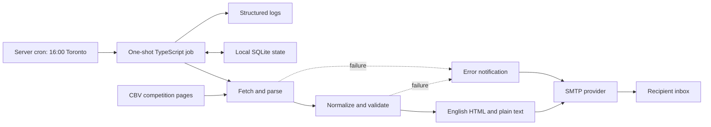

# Architecture and product requirements

## Purpose

Provide one concise daily email about Brazil's Superliga A, based on CBV's published website data. Replace manual checks of schedules, results, and standings with a scheduled job on the owner's server.

## Confirmed requirements

| Area | Requirement |
| --- | --- |
| Source | Scrape the official CBV website; no sports data API |
| Coverage | All teams in men's and women's Superliga A |
| Recipient | `vinicius@hisao.com.br` |
| Schedule | Every day at 16:00, `America/Toronto`, including daylight-saving changes |
| Language | English; retain official Portuguese team names |
| Content | Today's games, yesterday's results, men's standings, women's standings |
| Hosting | Owner's server, scheduled with cron |
| Failures | Send an error notification to the same recipient |
| Deliverables | High-level architecture and implementation specification in this repository |

The attached image defines content order and visual hierarchy. Its dates, scores, points, and sample teams are illustrative, not source data. Show every team in each standings table, rather than the three-row preview in the image.

## Design defaults

These decisions complete the specification where no preference was supplied:

- All displayed times and calendar-day boundaries use Toronto time; clearly label the timezone in the email.
- Start the job at 16:00; delivery follows retrieval and rendering. Exact inbox arrival at 16:00 is not guaranteed.
- Send every day, including days with no games. Show explicit empty-state text and available current standings.
- Use SMTP behind a transport interface. The provider and verified sender remain deployment choices.
- Do not send a normal digest if required source data is invalid or incomplete. Send an error notification instead.
- Preserve official rankings and points; do not independently calculate league tie-breakers.
- Keep the current season explicitly configured and validated. Season changes require an operator update.

## System overview

A one-shot process is sufficient: no web server, public endpoint, subscription system, or persistent worker is required. Cron invokes it, it acquires a lock, collects a coherent snapshot, renders and sends the email, records delivery state, and exits.

## Component responsibilities

| Component | Responsibility |
| --- | --- |
| Runner | Load validated configuration, fix the run date, obtain a lock, enforce a total time limit |
| CBV adapter | Retrieve public website pages and extract source records; isolate selectors and page-specific assumptions |
| Normalizer | Resolve teams, dates, scores, competitions, seasons, and match identities |
| Validator | Reject incomplete pages, wrong seasons, ambiguous dates, and invalid required fields |
| Digest builder | Select Toronto-day matches and build the four ordered sections |
| Renderer | Generate escaped, accessible HTML and equivalent plain text |
| Mail transport | Send normal or error email; classify definite rejection versus uncertain acceptance |
| State store | Track runs, validated snapshots, delivery attempts, and accepted messages |

## Email contract

Subject: `Superliga — October 26, 2026`

Body order:

1. **Superliga — Oct 26**, with season and timezone below it.
2. **Today's games**: chronological matches from both competitions, each labeled Men or Women. Format: `7:00 PM — Team A × Team B (Men)`. Include current status, and score if already completed.
3. **Yesterday**: matches assigned to the preceding Toronto date, with final set scores: `Team C 3 × 1 Team D (Women)`. If the source has not supplied a final result, say `Result pending`; do not invent a result or silently omit that match.
4. **Men's standings**: full official ranking, team name, points.
5. **Women's standings**: full official ranking, team name, points.
6. Footer: retrieval timestamp, Toronto timezone, source links, and any source-published update timestamp available.

Use a simple single-column layout, clear headings, ample spacing, and readable text similar to the reference. Support light and dark email clients without relying on a dark background. Tables must fit mobile screens; no scripts, remote fonts, or required images. A plain-text alternative must preserve all content.

Empty states: `No games scheduled today.` and `No games yesterday.` are permitted only after successful source and coverage validation. Standings unavailable before publication may be shown as `Not yet published by CBV` only when explicitly confirmed on the source. A blank table or missing selector is a failure.

Today's section includes matches earlier than 16:00 and matches still to come. Cancelled/postponed games retain their status when CBV identifies their original date. A rescheduled fixture belongs to its new confirmed date; do not duplicate it under the old date. During playoffs, show CBV's published standings with its phase label, even if the table remains the regular-season ranking.

## Scope and tradeoffs

Version one does not include favorite-team filtering, playoff alerts, calendar feeds, reminders, live scoring, TV-channel display, or subscriber management. Broadcast information exists on inspected CBV pages but is outside the reference layout and can be added later.

Website scraping couples the service to CBV's markup and publishing practices. Validation and saved fixtures reduce silent errors, but site changes will require maintenance. A once-daily snapshot can miss later schedule corrections or late results. Future late-result catch-up behavior should be designed explicitly rather than expanding yesterday's window silently.

SMTP acceptance is not proof of inbox delivery. A simultaneous server or mail-provider outage can prevent error emails; local logs and optional independent monitoring are necessary to diagnose that case.
